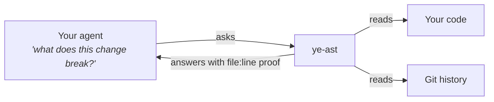
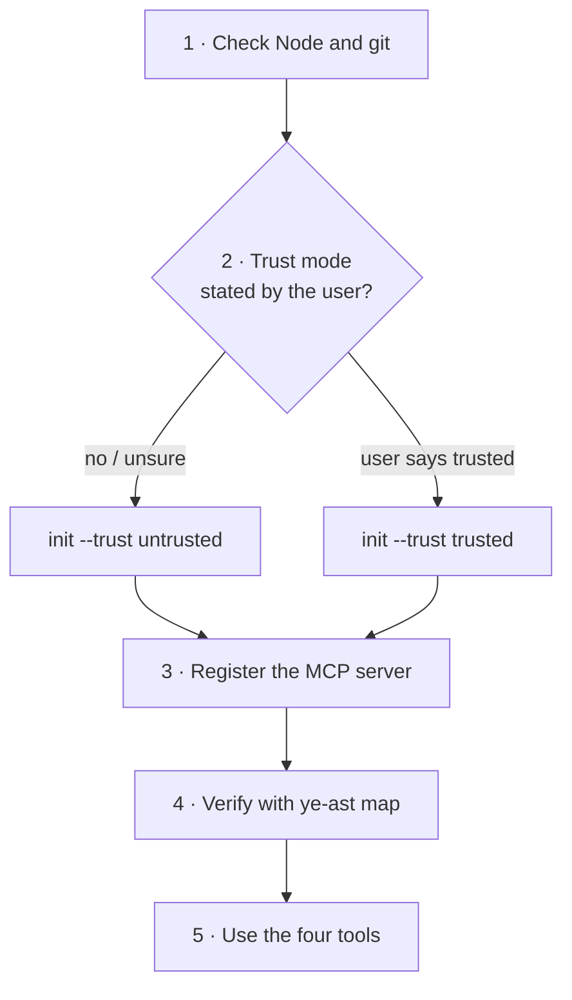
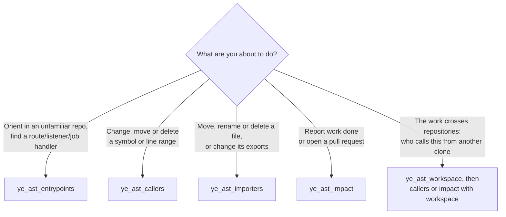
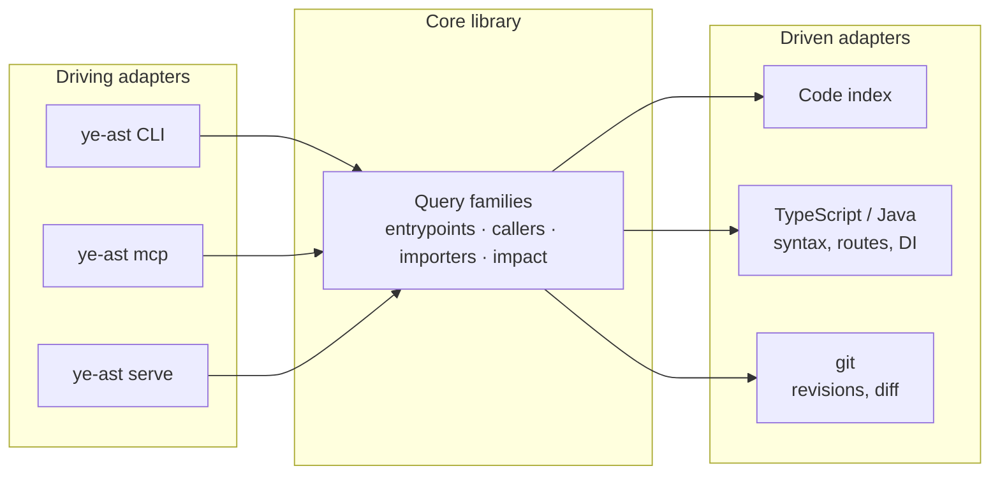

<div align="center">


<i>"What breaks if I rename this?" · "Which screen uses this?" · "Is this file really dead?" · "What does my branch touch?"</i>

[](https://www.npmjs.com/package/ye-ast-mcp)
[](LICENSE)
[](package.json)
[](#3-register-the-mcp-server)

**[Why](#why) · [What it does](#what-it-does) · [Try it](#try-it) · [Limits](#limits) · [For AI agents →](#for-ai-agents-install-and-configure-ye-ast) · [Live explorer →](https://arielfalcon.github.io/ye-ast/explorer/)**

</div>

---

## Why

Your AI agent sees a handful of files and guesses the rest. It renames a function, says "done", and two days later a
screen that called it through a path the agent never opened is broken.

ye-ast gives your agent **the map**: who calls what, which screen or endpoint each piece of code ends up serving, and
what your branch really touches. Every answer points to the file and line it came from.



## What it does

<table>
<tr>
<td width="36" valign="top"></td>
<td>
<b>What does my branch touch?</b> Everything downstream of your change, plus the routes it adds, removes or alters.<br/>
<sub><b>Under the hood:</b> every path is scored by its weakest link, because a chain of calls is only as sure as its
least sure step. The walk covers an 18,000-node graph in about 10 ms. It measures from where you branched off, so
work merged after you never shows up as yours.</sub>
</td>
</tr>
<tr>
<td valign="top"></td>
<td>
<b>Who calls this?</b> Every caller of a function or a range of lines, before you rename or delete it.<br/>
<sub><b>Under the hood:</b> it resolves calls made through injected services, which a text search can't connect and the
code index alone leaves unresolved.</sub>
</td>
</tr>
<tr>
<td valign="top"></td>
<td>
<b>Which screen ends up running this?</b> UI routes, HTTP endpoints, message listeners and scheduled jobs.<br/>
<sub><b>Under the hood:</b> touch a route guard and it tells you every screen behind it.</sub>
</td>
</tr>
<tr>
<td valign="top"></td>
<td><b>Is this file dead?</b> Who imports it and who uses it, file by file.</td>
</tr>
<tr>
<td valign="top"></td>
<td><b>What's in this repo?</b> Every way into the app, as the starting point in an unfamiliar codebase.</td>
</tr>
<tr>
<td valign="top"></td>
<td>
<b>When it doesn't know, it says so.</b> No empty list that reads as "all clear".<br/>
<sub><b>Under the hood:</b> each place it couldn't settle comes back as a <code>file:line</code> to open, never a silent guess.</sub>
</td>
</tr>
</table>

## Why trust it

| | |
|---|---|
|  | **No AI inside.** Answers come from code and git. Same repo, same bytes, every time. |
|  | **Read-only.** Your agent can't use it to change anything. |
|  | **Safe by default.** It reads committed code straight from git, runs nothing from the repo and makes no network calls. |
|  | **Keeps up with your edits.** When you allow it, it re-reads only what changed: 370 ms instead of 2.4 s on a 1,100-file repo. |
|  | **Plugs into your agent.** It speaks MCP, so Claude Code, OpenCode and any other MCP client work. |

## Try it

With Node.js 24.15+ and git 2.44+, inside any repository:

```bash
npx ye-ast-mcp init --trust untrusted .
```

It prints one line that connects it to your agent. Or just **hand this README to your agent**: the second half is
written for it.

## Limits

-  **TypeScript and Java** today, with Angular routes and Spring HTTP routes. Anything else is reported as not covered.
-  **Structure, not intent.** "What reaches this?" yes. "Is this code good?" no.
-  **Version 0.x.** Solid answers; the surface may still change.

---

<div align="center">

## For AI agents: install and configure ye-ast

<sub>Everything below is written for an agent. Humans are welcome, but it gets technical from here.</sub>

</div>

You are an agent asked to add ye-ast to a repository and use it. Follow the steps in order. Every command is exact and
every expected result is stated.

> [!IMPORTANT]
> **Do not skip step 2 and do not choose `trusted` for the user.** The trust mode is the user's decision.



### Contents

1. [Check the preconditions](#1-check-the-preconditions)
2. [Declare the trust mode](#2-declare-the-trust-mode)
3. [Register the MCP server](#3-register-the-mcp-server)
4. [Verify before reporting success](#4-verify-before-reporting-success)
5. [Choose the tool](#5-choose-the-tool)
6. [Read the answer correctly](#6-read-the-answer-correctly)
7. [Failures and what they mean](#7-failures-and-what-they-mean)
8. [Rules you must respect](#8-rules-you-must-respect)
9. [CLI reference](#9-cli-reference)

### 1. Check the preconditions

```bash
node --version                  # must be v24.15.0 or newer
git --version                   # must be 2.44 or newer
git rev-parse --show-toplevel   # must print the repository root
```

| If | Then |
|---|---|
| Node is older than 24.15 | Stop and tell the user. The engine uses `node:sqlite` and refuses to run. |
| The directory is not a git repository | Stop. Every fact reads git history. |
| `git rev-parse` prints a different root than the path you were given | Use the printed root as `<repo>` in every step below. |

The npm package is `ye-ast-mcp`; the command it installs is `ye-ast`. Every step works without a global install
through `npx --yes ye-ast-mcp …`. With `npm install -g ye-ast-mcp`, replace `npx --yes ye-ast-mcp` with `ye-ast`.

### 2. Declare the trust mode

The two modes describe the **repository content**, not the machine, and are recorded **outside** the repository.
Nothing inside a repository can raise its own mode. With no declaration, the CLI and the MCP server run `untrusted`.

| Mode | What ye-ast does | Use when |
|---|---|---|
| `untrusted` (default) | Reads only a snapshot exported from git at a sha. No network request, no repository manifest, no repository `.gitignore`, no repository code, no symlinks. | Always, unless the user says otherwise. Every query against a committed revision works. |
| `trusted` | Also allows `live`: reads the working tree (uncommitted and untracked files included) from ye-ast's own mirror, and refreshes declared remotes with the user's git. | Only when the user explicitly says the repository content is trusted. |

Ask the user only if you cannot decide from context. Never infer consent from the fact that the repository is theirs.

```bash
npx --yes ye-ast-mcp init --trust untrusted /path/to/repo
```

Expected output, one item per line:

```text
trust: untrusted (recorded outside the repository)
local exclude: added .ye-ast/ .ye-ast-graph/
.ye-ast/README.md: written
.ye-ast/entrypoints.json: written
register the MCP server with Claude Code:
claude mcp add ye-ast -- npx --yes ye-ast-mcp mcp /path/to/repo
```

What `init` did:

- recorded the trust declaration in `$XDG_CONFIG_HOME/ye-ast/` (`~/.config/ye-ast/` by default);
- wrote the fixed layer under `.ye-ast/` (owned by `init`; never edit it by hand);
- added `.ye-ast/` and `.ye-ast-graph/` to `.git/info/exclude`, so nothing reaches the user's commits;
- printed the MCP registration for **this** machine. Use that last line in step 3.

### 3. Register the MCP server

One server instance is bound to **one** repository root, and the instructions it answers at `initialize` name that root:
every path in an answer is relative to it. Always pass the path: an MCP client may start the server in any working
directory.

<details open>
<summary><b>Claude Code</b></summary>

User scope (available in every session):

```bash
claude mcp add ye-ast -s user -- npx --yes ye-ast-mcp mcp /path/to/repo
```

Project scope (writes `.mcp.json`, shared with the team): replace `-s user` with `-s project`.

</details>

<details>
<summary><b>OpenCode</b></summary>

Merge into `opencode.json` (project) or the global config:

```json
{
  "$schema": "https://opencode.ai/config.json",
  "mcp": {
    "ye-ast": {
      "type": "local",
      "command": ["npx", "-y", "ye-ast-mcp", "mcp", "/path/to/repo"],
      "enabled": true
    }
  }
}
```

</details>

<details>
<summary><b>Any other stdio MCP client</b></summary>

| Field | Value |
|---|---|
| transport | stdio |
| command | `npx` |
| arguments | `-y`, `ye-ast-mcp`, `mcp`, `/path/to/repo` |

</details>

<details>
<summary><b>More than one repository</b></summary>

Register one entry per repository, each with its own name and path:

```bash
claude mcp add ye-ast-api -s user -- npx --yes ye-ast-mcp mcp /path/to/api
claude mcp add ye-ast-web -s user -- npx --yes ye-ast-mcp mcp /path/to/web
```

</details>

### 4. Verify before reporting success

Run the same query through the CLI. It is the same engine the MCP server uses:

```bash
npx --yes ye-ast-mcp map /path/to/repo
```

- [ ] Exit code is `0`.
- [ ] stdout is one JSON object with `schema`, `snapshot`, `producer`, `inputs`, `evidence`, `status` and `value`.
- [ ] `status` is `complete` or `partial`. Both are valid answers.
- [ ] `value.entrypoints` is an object, not `null`.
- [ ] If the client lists MCP tools: `ye_ast_entrypoints`, `ye_ast_callers`, `ye_ast_importers`, `ye_ast_impact` and `ye_ast_workspace`
      appear. The client may need a restart to pick up a new server.

A non-zero exit code is a query problem, not a registration problem: read [step 7](#7-failures-and-what-they-mean).

### 5. Choose the tool



| Tool | Call it when | Key arguments |
|---|---|---|
| `ye_ast_entrypoints` | You are orienting, or you need the handler of a UI route, HTTP route, message listener or scheduled job | `revision`, `live`, `scope` |
| `ye_ast_callers` | **Before** changing, moving or deleting a symbol or a line range | `targets: [{ file, symbol }]` (a member as `Class.member`) or `[{ file, start, end }]`, `revision`, `live`, `scope`, `budget`, `detail`, `workspace` |
| `ye_ast_importers` | Before moving, renaming or deleting a file, or changing its exports | `files: [repo-relative paths]`, `revision`, `live`, `scope` |
| `ye_ast_impact` | Before reporting work done or opening a pull request | `base` (the branch the work merges into), `head`, `live`, `scope`, `budget`, `detail`, `workspace` |
| `ye_ast_workspace` | The work crosses repositories: it lists the hosts, path prefixes, configuration URLs, dependency coordinates, remotes and registries the repository writes outward, the local clones that serve each one, and the names no clone serves | `repos: [{ path, id?, revision? }]`, `gateways`, `revision`, `scope` |

How the arguments behave:

| Argument | Meaning |
|---|---|
| `revision` / `head` | Any git revision. Default: `HEAD`. |
| `live` | Read the working tree instead of a revision. Requires `trusted`; exclusive with `revision`/`head`. |
| `workspace` | `{ repos: [{ path, id?, revision? }], gateways?: [{ prefix, repo }] }` on `callers` and `impact`: other **local** clones whose call sites are joined to the routes and listeners the walk reaches. The answer adds the links (with their basis: `exact`, `gateway-prefix`, `route-overlap`, `base-path`, `suffix`, `event-destination`), each with its direction (`upstream` for what reaches the change, `downstream` for what a change sends onward) and the links crossed from the change (`reach`), followed to a fixpoint across repositories; what depends on those call sites in their own repository, the call sites that reached a declared service and matched none of its entrypoints (`unmatched`), the ones that name a service no clone serves (`external`), and every call site whose target the code does not decide as a cut. A gateway prefix needs no declaration when the routes show it; `gateways` overrides it, and a declared gateway no call site names, or whose repository was not passed, is listed as matching nothing. Without `repos` the repositories and gateways the user persisted with `ye-ast init --workspace <file>` are used, and a repository that persists none answers about itself alone; the manifest holds the same object, its relative paths resolved against the installed repository. Every answer says which of the two declared its repositories (`workspace.source`: `request`, `persisted` or `none`), so an answer about the bound repository alone is never read as a workspace with no impact. Each clone is read at its own snapshot under its own trust declaration, with no network request; exclusive with `live`. Without `workspace` the answer says nothing about other repositories. |
| `scope` | `{ include?: [globs], exclude?: [globs] }` over repository-relative paths; `exclude` wins. `include` selects the content the answer is about, and the configuration that interprets it (a `package.json`, a `tsconfig`, a build file, a Spring `application` file, an OpenAPI document) is always read, so narrowing never hides what an extractor needs to place a source. A path outside the scope is **not answered about**, so callers and entrypoints through it are not known; the answer names its scope under its status. Use it to keep one service or package apart, not to shorten an answer. |
| `budget` | `{ depth?, hubFanIn?, expansions? }`, positive integers, no defaults. A bound that stops a walk is reported as a cut, never as a silent truncation. |
| `detail` | Text listing for `callers` and `impact`. Default: depth 0 and 1 listed, deeper symbols counted per file. `"full"` lists every symbol. The structured content always holds all of them. |

Working rules:

- Prefer these tools over `grep` and over your own inference whenever the decision depends on **what reaches what**.
  Do not use them for style, naming or syntax questions.
- Call `ye_ast_callers` **before** deleting a declaration. Once it is gone, `ye_ast_impact` can only list the places
  that still name it.
- Name symbols as they are declared in the file: `placeOrder`, or `OrderService.placeOrder` for a member.
- To shorten an answer, rely on `detail`, not `scope`: a scope hides whatever lies outside it, routes included.

### 6. Read the answer correctly

Every answer is one envelope:

```text
schema     contract version of the envelope
snapshot   what was read: { kind: "sha", sha } or { kind: "live" }
producer   ye-ast name and version
inputs     trust mode, declared scope, budget
evidence   [{ path, line }] that support the value
status     complete | partial | unknown
value      the fact itself
```

| `status` | Means | What you report |
|---|---|---|
| `complete` | Everything inside `inputs.declaredScope` was read | The answer, and that it holds **inside** the declared scope only |
| `partial` | The answer stops at each entry in `cuts`; what lies past a cut is **not known** | The answer plus the cuts. The server instructions say what to do for each cut kind; an `unresolved-link` lists places to open and decide yourself |
| `unknown` | ye-ast cannot tell; `reason` says why | The reason. **Never** translate it into "no impact" |

> [!WARNING]
> An empty list is never used to mean "nothing found". If you see `unknown` or a cut, say so to the user.

An item can also be `unknown` inside a `complete` answer: an entrypoint whose target the sources do not resolve, or a
source no `package.json` above it places in a project (`no-project`). The collection is complete because nothing bounded
it; the item says what could not be known at its place (RFC-0002 rule 2).

`complete` stays relative to the declared scope, and the scope now separates content from interpretation: `include`
selects the content the answer is about, and the configuration that interprets it — a `package.json`, a `tsconfig`, a
build file, a Spring `application` file, an OpenAPI document — is always read, so narrowing the scope never removes what
an extractor needs to place a source. `exclude` still wins over both, and a path a tool is asked about outside the scope
stays out of scope.

Also:

- Quote the `snapshot` when you report a fact, so the user knows which revision it describes.
- The text of every answer opens with `status`, the `declared scope` that status is relative to, the `scope` the caller
  narrowed and the `snapshot`; a refreshed workspace answer adds a `remote:` line per remote and a `pinned:` line per
  repository before them, so a text-only read loses nothing the fact's siblings carry.
- `_meta["ye-ast/live"]` on a live answer means the working tree moved during the read; the answer may be stale.
- An `isError` result carries a fault kind on its first text line and the same `{ kind, detail, entries? }` in
  `_meta["ye-ast/fault"]`; see the next step.

### 7. Failures and what they mean

| Symptom | Cause | Action |
|---|---|---|
| `ye-ast: unreadable: …` | The path is not readable or not a git repository | Fix the path; do not retry blindly |
| `ye-ast: live-requires-trusted` | `live` used without a `trusted` declaration | Ask the user, or answer from a revision |
| `ye-ast: unknown-symbol: …` | Nothing declares that symbol at that revision | Check the file and the name; the error lists what it found |
| `ye-ast: deadline` | The walk ran out of its bound | Narrow `scope`, or raise `budget` |
| `ye-ast: caller-budget` | A host-set export budget stopped the read | Raise the budget set by the host |
| `ye-ast: unsupported-store: …` | An index store outside the supported schema | Let ye-ast rebuild its index |
| Tools missing in the client | Server not registered, or client not restarted | Re-run step 3, restart the client, re-check step 4 |

| Exit code | Meaning |
|---|---|
| `0` | OK |
| `1` | The query failed with a typed fault (table above) |
| `2` | Usage error: re-read `ye-ast --help` |
| `70` | Internal fault: report the message, do not retry in a loop |
| `130` | Interrupted |

### 8. Rules you must respect

- ye-ast is **read-only** toward the repository. Never write, edit or delete files to make a query succeed.
- Never fabricate a fact. If the answer is `unknown` or cut, report that.
- Never mark a repository `trusted` on your own initiative.
- Under `untrusted` ye-ast makes no network request; do not work around that by fetching the repository yourself.
- The fixed layer under `.ye-ast/` belongs to `ye-ast init`. Do not edit it by hand.

### 9. CLI reference

The CLI answers the same questions as the MCP tools, as one JSON object on stdout. Use it in scripts, CI, or to verify
an MCP answer.

```bash
ye-ast map .                                    # entrypoints at HEAD
ye-ast impact --base main .                     # what the current branch affects
ye-ast callers . src/checkout.ts:placeOrder     # who depends on a symbol
ye-ast callers . src/checkout.ts:40-72          # who depends on a line range
ye-ast importers . src/checkout.ts              # who imports or uses a file
ye-ast map --live .                             # the working tree (trusted only)
```

| Command | Answers |
|---|---|
| `ye-ast map [--revision <rev> \| --live] [scope] <repo>` | Entrypoints of a revision |
| `ye-ast impact --base <rev> [--head <rev> \| --live] [scope] [budget] <repo>` | What depends on the change from the merge base to the head |
| `ye-ast callers [--revision <rev> \| --live] [scope] [budget] <repo> <file>:<symbol> \| <file>:<start>-<end> …` | What depends on symbols or line ranges |
| `ye-ast importers [--revision <rev> \| --live] [scope] <repo> <file> …` | Per file: importers, users and unresolved namers |
| `ye-ast init --trust trusted\|untrusted [--workspace <file>] [<repo>]` | Declares the trust mode, writes the fixed layer (and the workspace manifest given, once every repository it names is a readable repository root), prints the MCP registration |
| `ye-ast mcp [<repo>]` | The stdio MCP server, read-only, bound to one repository |
| `ye-ast serve` | The query protocol over stdio, one JSON-RPC 2.0 message per line |

| Option group | Syntax |
|---|---|
| `scope` | `[--include <glob>]… [--exclude <glob>]…` over repository-relative paths; `--exclude` wins |
| `budget` | `[--depth <n>] [--hub-fan-in <n>] [--expansions <n>]`; positive integers, no defaults |
| identity | `--repo-id <id>` names the repository in every snapshot |
| measurement | `--measure` writes one JSON measurement line per query and per index build to stderr, never stdout |

<details>
<summary><b>Embedding the engine as a library</b></summary>

For a host that runs the engine in its own process:

```js
import { composeQueries } from "ye-ast-mcp";

const { entrypoints, impact } = composeQueries({ indexCache: "/var/cache/ye-ast" });
const result = await impact.callers({
  repo: "/path/to/repo",
  repoId: "my-app",
  revision: "HEAD",
  targets: [{ file: "src/checkout.ts", symbol: "placeOrder" }],
});
```

`composeQueries` returns the read query families and `warmLive`; nothing it exposes can write.

</details>

<details>
<summary><b>How it is built</b></summary>



The core is a library with ports; the CLI, the MCP server and the query protocol are thin adapters over it. The same
core answers a one-shot `ye-ast impact` in CI and an on-demand `ye_ast_impact` from an agent. Design records live in
[docs/architecture](docs/architecture/README.md).

</details>

<details>
<summary><b>Development</b></summary>

```bash
nvm use
npm ci
npm run check     # typecheck + architecture rules + tests
npm run cli -- map .
```

`npm run arch:check` enforces the layers: domain and ports never reach a Node built-in, application never reaches an
adapter, and an entrypoint never imports another entrypoint.

</details>

---

<div align="center">

Apache-2.0 · See [LICENSE](LICENSE)


</div>
