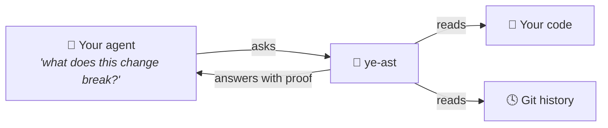
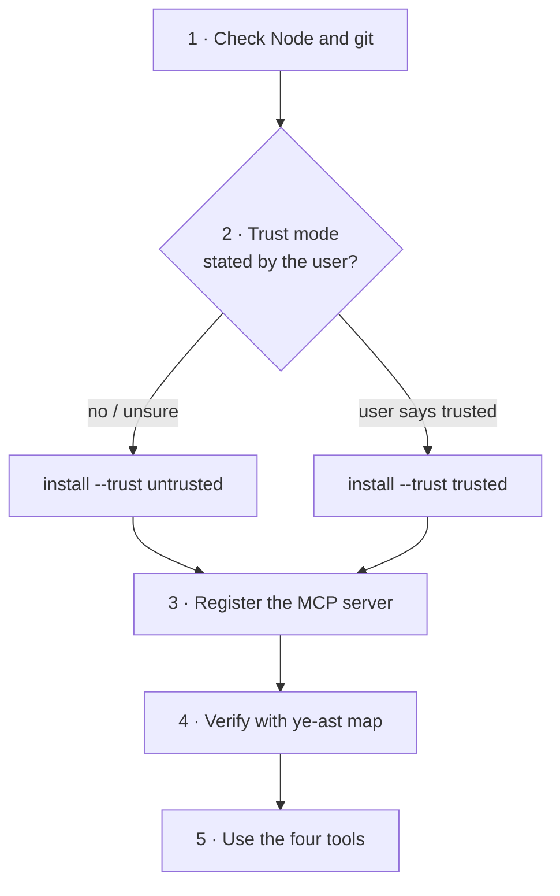
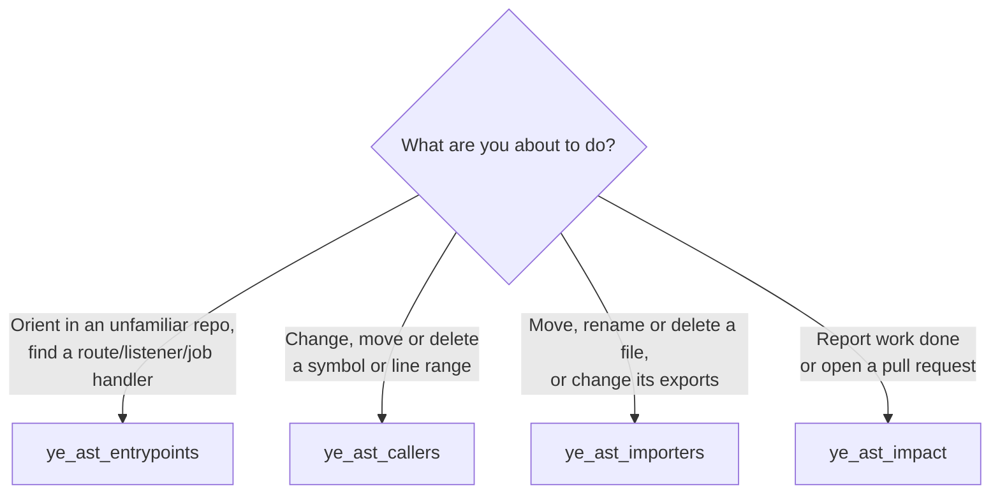
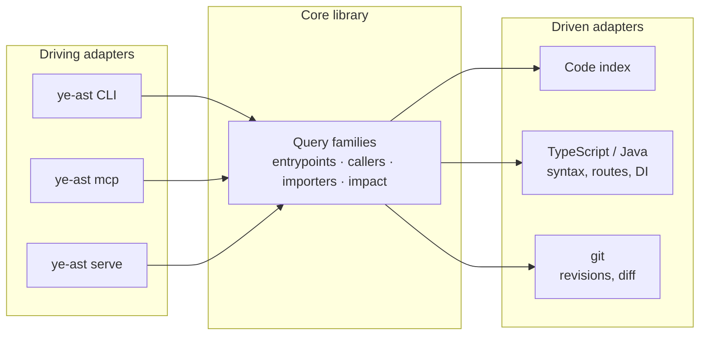

<div align="center">


<i>"What breaks if I rename this?" · "Which screen uses this?" · "Is this file really dead?" · "What does my branch touch?"</i>

[](https://www.npmjs.com/package/ye-ast-mcp)
[](LICENSE)
[](package.json)
[](#3-register-the-mcp-server)

**[Why](#the-problem) · [What you get](#what-you-get) · [Try it](#try-it-in-two-minutes) · [Limits](#what-it-does-not-do) · [For AI agents →](#for-ai-agents-install-and-configure-ye-ast)**

</div>

---

## The problem

You ask your AI agent to rename a function. It reads three files, greps the name, and says "done". Two days later a
screen nobody tested is broken, because something called that function through a path the agent never opened.

It is not that the agent is bad. It just **can't see the whole map**. It sees a handful of files and fills the rest
with a confident guess.

## What ye-ast does about it

ye-ast reads your repository and git history and hands your agent **the map**: who calls what, which screen or
endpoint each piece of code ends up serving, and what your branch really touches. Every answer points to the exact
file and line it came from, so the agent (and you) can check it.



> [!TIP]
> Think of it as giving your agent the "Find all references" and "Go to definition" a senior dev uses without
> thinking, plus "which page of the app ends up running this?", all in one question.

## What you get

| | Before | With ye-ast |
|---|---|---|
| 🔁 **Renaming or deleting** | "I searched the name, looks unused" | The full list of callers, with file and line |
| 🖥️ **"Where is this used?"** | The agent guesses from folder names | The real screens, API routes, listeners and jobs it reaches |
| 🌿 **Before a pull request** | "I only changed two files" | Everything downstream of those two files, and the routes that changed |
| 🗺️ **New repository** | Reading folders at random | A list of every way into the app, as a starting point |
| ❓ **When it doesn't know** | Silence, read as "all good" | It says so, and tells you exactly where it stopped |

That last row is the important one. ye-ast **never pretends**. If it can't finish an answer, it tells you where the
answer ends instead of handing back an empty list that looks like "nothing to worry about".

## Why you can trust it

- 🎯 **No AI inside.** The answers come from code and git, not from another model. Same repo, same answer, every time.
- 🔒 **Read-only.** It never writes to your code. Your agent can't use it to change anything.
- 🛡️ **Safe by default.** Unless you say otherwise, it only reads what is committed, runs nothing from the
  repository, and makes no network calls.
- 🔌 **Works with your agent.** It speaks MCP, the standard way agents plug in tools. Claude Code, OpenCode and any
  other MCP client work.

## Try it in two minutes

You need Node.js 24.15+ and git 2.44+. Then, inside any repository:

```bash
npx ye-ast-mcp install --trust untrusted .
```

That's it. The command prints one line to connect it to your agent; paste it, and your agent now has four new tools.
Or, easier: **give this README to your agent and ask it to set ye-ast up.** The second half is written for it.

## What it does not do

Being honest about the edges:

- 🧩 **Languages today:** TypeScript and Java, with Angular routes and Spring HTTP routes understood. Code in other
  languages is reported as "not covered", never silently skipped.
- 🧠 **It answers structure, not intent.** "What reaches this?" yes. "Is this code good?" no.
- 🚧 **Early days.** Version 0.x: the answers are solid, the surface may still change.

---

<div align="center">

## For AI agents: install and configure ye-ast

<sub>Everything below is written for an agent. Humans are welcome, but it gets technical from here.</sub>

</div>

You are an agent asked to add ye-ast to a repository and use it. Follow the steps in order. Every command is exact and
every expected result is stated.

> [!IMPORTANT]
> **Do not skip step 2 and do not choose `trusted` for the user.** The trust mode is the user's decision.



### Contents

1. [Check the preconditions](#1-check-the-preconditions)
2. [Declare the trust mode](#2-declare-the-trust-mode)
3. [Register the MCP server](#3-register-the-mcp-server)
4. [Verify before reporting success](#4-verify-before-reporting-success)
5. [Choose the tool](#5-choose-the-tool)
6. [Read the answer correctly](#6-read-the-answer-correctly)
7. [Failures and what they mean](#7-failures-and-what-they-mean)
8. [Rules you must respect](#8-rules-you-must-respect)
9. [CLI reference](#9-cli-reference)

### 1. Check the preconditions

```bash
node --version                  # must be v24.15.0 or newer
git --version                   # must be 2.44 or newer
git rev-parse --show-toplevel   # must print the repository root
```

| If | Then |
|---|---|
| Node is older than 24.15 | Stop and tell the user. The engine uses `node:sqlite` and refuses to run. |
| The directory is not a git repository | Stop. Every fact reads git history. |
| `git rev-parse` prints a different root than the path you were given | Use the printed root as `<repo>` in every step below. |

The npm package is `ye-ast-mcp`; the command it installs is `ye-ast`. Every step works without a global install
through `npx --yes ye-ast-mcp …`. With `npm install -g ye-ast-mcp`, replace `npx --yes ye-ast-mcp` with `ye-ast`.

### 2. Declare the trust mode

The two modes describe the **repository content**, not the machine, and are recorded **outside** the repository.
Nothing inside a repository can raise its own mode. With no declaration, the CLI and the MCP server run `untrusted`.

| Mode | What ye-ast does | Use when |
|---|---|---|
| `untrusted` (default) | Reads only a snapshot exported from git at a sha. No network request, no repository manifest, no repository `.gitignore`, no repository code, no symlinks. | Always, unless the user says otherwise. Every query against a committed revision works. |
| `trusted` | Also allows `live`: reads the working tree (uncommitted and untracked files included) from ye-ast's own mirror, and refreshes declared remotes with the user's git. | Only when the user explicitly says the repository content is trusted. |

Ask the user only if you cannot decide from context. Never infer consent from the fact that the repository is theirs.

```bash
npx --yes ye-ast-mcp install --trust untrusted /path/to/repo
```

Expected output, one item per line:

```text
trust: untrusted (recorded outside the repository)
local exclude: added .ye-ast/ .ye-ast-graph/
.ye-ast/README.md: written
.ye-ast/entrypoints.json: written
register the MCP server with Claude Code:
claude mcp add ye-ast -- npx --yes ye-ast-mcp mcp /path/to/repo
```

What `install` did:

- recorded the trust declaration in `$XDG_CONFIG_HOME/ye-ast/` (`~/.config/ye-ast/` by default);
- wrote the fixed layer under `.ye-ast/` (owned by `install`; never edit it by hand);
- added `.ye-ast/` and `.ye-ast-graph/` to `.git/info/exclude`, so nothing reaches the user's commits;
- printed the MCP registration for **this** machine. Use that last line in step 3.

### 3. Register the MCP server

One server instance is bound to **one** repository root. Always pass the path: an MCP client may start the server in
any working directory.

<details open>
<summary><b>Claude Code</b></summary>

User scope (available in every session):

```bash
claude mcp add ye-ast -s user -- npx --yes ye-ast-mcp mcp /path/to/repo
```

Project scope (writes `.mcp.json`, shared with the team): replace `-s user` with `-s project`.

</details>

<details>
<summary><b>OpenCode</b></summary>

Merge into `opencode.json` (project) or the global config:

```json
{
  "$schema": "https://opencode.ai/config.json",
  "mcp": {
    "ye-ast": {
      "type": "local",
      "command": ["npx", "-y", "ye-ast-mcp", "mcp", "/path/to/repo"],
      "enabled": true
    }
  }
}
```

</details>

<details>
<summary><b>Any other stdio MCP client</b></summary>

| Field | Value |
|---|---|
| transport | stdio |
| command | `npx` |
| arguments | `-y`, `ye-ast-mcp`, `mcp`, `/path/to/repo` |

</details>

<details>
<summary><b>More than one repository</b></summary>

Register one entry per repository, each with its own name and path:

```bash
claude mcp add ye-ast-api -s user -- npx --yes ye-ast-mcp mcp /path/to/api
claude mcp add ye-ast-web -s user -- npx --yes ye-ast-mcp mcp /path/to/web
```

</details>

### 4. Verify before reporting success

Run the same query through the CLI. It is the same engine the MCP server uses:

```bash
npx --yes ye-ast-mcp map /path/to/repo
```

- [ ] Exit code is `0`.
- [ ] stdout is one JSON object with `schema`, `snapshot`, `producer`, `inputs`, `evidence`, `status` and `value`.
- [ ] `status` is `complete` or `partial`. Both are valid answers.
- [ ] `value.entrypoints` is an object, not `null`.
- [ ] If the client lists MCP tools: `ye_ast_entrypoints`, `ye_ast_callers`, `ye_ast_importers` and `ye_ast_impact`
      appear. The client may need a restart to pick up a new server.

A non-zero exit code is a query problem, not a registration problem: read [step 7](#7-failures-and-what-they-mean).

### 5. Choose the tool



| Tool | Call it when | Key arguments |
|---|---|---|
| `ye_ast_entrypoints` | You are orienting, or you need the handler of a UI route, HTTP route, message listener or scheduled job | `revision`, `live`, `scope` |
| `ye_ast_callers` | **Before** changing, moving or deleting a symbol or a line range | `targets: [{ file, symbol }]` (a member as `Class.member`) or `[{ file, start, end }]`, `revision`, `live`, `scope`, `budget`, `detail` |
| `ye_ast_importers` | Before moving, renaming or deleting a file, or changing its exports | `files: [repo-relative paths]`, `revision`, `live`, `scope` |
| `ye_ast_impact` | Before reporting work done or opening a pull request | `base` (the branch the work merges into), `head`, `live`, `scope`, `budget`, `detail` |

How the arguments behave:

| Argument | Meaning |
|---|---|
| `revision` / `head` | Any git revision. Default: `HEAD`. |
| `live` | Read the working tree instead of a revision. Requires `trusted`; exclusive with `revision`/`head`. |
| `scope` | `{ include?: [globs], exclude?: [globs] }` over repository-relative paths; `exclude` wins. A path left out is **not read**, so keep the files that declare routes inside it. |
| `budget` | `{ depth?, hubFanIn?, expansions? }`, positive integers, no defaults. A bound that stops a walk is reported as a cut, never as a silent truncation. |
| `detail` | Text listing for `callers` and `impact`. Default: depth 0 and 1 listed, deeper symbols counted per file. `"full"` lists every symbol. The structured content always holds all of them. |

Working rules:

- Prefer these tools over `grep` and over your own inference whenever the decision depends on **what reaches what**.
  Do not use them for style, naming or syntax questions.
- Call `ye_ast_callers` **before** deleting a declaration. Once it is gone, `ye_ast_impact` can only list the places
  that still name it.
- Name symbols as they are declared in the file: `placeOrder`, or `OrderService.placeOrder` for a member.
- Narrow with `scope` before raising `budget`: it is cheaper and keeps the answer focused.

### 6. Read the answer correctly

Every answer is one envelope:

```text
schema     contract version of the envelope
snapshot   what was read: { kind: "sha", sha } or { kind: "live" }
producer   ye-ast name and version
inputs     trust mode, declared scope, budget
evidence   [{ path, line }] that support the value
status     complete | partial | unknown
value      the fact itself
```

| `status` | Means | What you report |
|---|---|---|
| `complete` | Everything inside `inputs.declaredScope` was read | The answer, and that it holds **inside** the declared scope only |
| `partial` | The answer stops at each entry in `cuts`; what lies past a cut is **not known** | The answer plus the cuts. The server instructions say what to do for each cut kind; an `unresolved-link` lists places to open and decide yourself |
| `unknown` | ye-ast cannot tell; `reason` says why | The reason. **Never** translate it into "no impact" |

> [!WARNING]
> An empty list is never used to mean "nothing found". If you see `unknown` or a cut, say so to the user.

Also:

- Quote the `snapshot` when you report a fact, so the user knows which revision it describes.
- `_meta["ye-ast/live"]` on a live answer means the working tree moved during the read; the answer may be stale.
- An `isError` result carries a fault kind; see the next step.

### 7. Failures and what they mean

| Symptom | Cause | Action |
|---|---|---|
| `ye-ast: unreadable: …` | The path is not readable or not a git repository | Fix the path; do not retry blindly |
| `ye-ast: live-requires-trusted` | `live` used without a `trusted` declaration | Ask the user, or answer from a revision |
| `ye-ast: unknown-symbol: …` | Nothing declares that symbol at that revision | Check the file and the name; the error lists what it found |
| `ye-ast: deadline` | The walk ran out of its bound | Narrow `scope`, or raise `budget` |
| `ye-ast: caller-budget` | A host-set export budget stopped the read | Raise the budget set by the host |
| `ye-ast: unsupported-store: …` | An index store outside the supported schema | Let ye-ast rebuild its index |
| Tools missing in the client | Server not registered, or client not restarted | Re-run step 3, restart the client, re-check step 4 |

| Exit code | Meaning |
|---|---|
| `0` | OK |
| `1` | The query failed with a typed fault (table above) |
| `2` | Usage error: re-read `ye-ast --help` |
| `70` | Internal fault: report the message, do not retry in a loop |
| `130` | Interrupted |

### 8. Rules you must respect

- ye-ast is **read-only** toward the repository. Never write, edit or delete files to make a query succeed.
- Never fabricate a fact. If the answer is `unknown` or cut, report that.
- Never mark a repository `trusted` on your own initiative.
- Under `untrusted` ye-ast makes no network request; do not work around that by fetching the repository yourself.
- The fixed layer under `.ye-ast/` belongs to `ye-ast install`. Do not edit it by hand.

### 9. CLI reference

The CLI answers the same questions as the MCP tools, as one JSON object on stdout. Use it in scripts, CI, or to verify
an MCP answer.

```bash
ye-ast map .                                    # entrypoints at HEAD
ye-ast impact --base main .                     # what the current branch affects
ye-ast callers . src/checkout.ts:placeOrder     # who depends on a symbol
ye-ast callers . src/checkout.ts:40-72          # who depends on a line range
ye-ast importers . src/checkout.ts              # who imports or uses a file
ye-ast map --live .                             # the working tree (trusted only)
```

| Command | Answers |
|---|---|
| `ye-ast map [--revision <rev> \| --live] [scope] <repo>` | Entrypoints of a revision |
| `ye-ast impact --base <rev> [--head <rev> \| --live] [scope] [budget] <repo>` | What depends on the change from the merge base to the head |
| `ye-ast callers [--revision <rev> \| --live] [scope] [budget] <repo> <file>:<symbol> \| <file>:<start>-<end> …` | What depends on symbols or line ranges |
| `ye-ast importers [--revision <rev> \| --live] [scope] <repo> <file> …` | Per file: importers, users and unresolved namers |
| `ye-ast install --trust trusted\|untrusted [<repo>]` | Declares the trust mode, writes the fixed layer, prints the MCP registration |
| `ye-ast mcp [<repo>]` | The stdio MCP server, read-only, bound to one repository |
| `ye-ast serve` | The query protocol over stdio, one JSON-RPC 2.0 message per line |

| Option group | Syntax |
|---|---|
| `scope` | `[--include <glob>]… [--exclude <glob>]…` over repository-relative paths; `--exclude` wins |
| `budget` | `[--depth <n>] [--hub-fan-in <n>] [--expansions <n>]`; positive integers, no defaults |
| identity | `--repo-id <id>` names the repository in every snapshot |
| measurement | `--measure` writes one JSON measurement line per query and per index build to stderr, never stdout |

<details>
<summary><b>Embedding the engine as a library</b></summary>

For a host that runs the engine in its own process:

```js
import { composeQueries } from "ye-ast-mcp";

const { entrypoints, impact } = composeQueries({ indexCache: "/var/cache/ye-ast" });
const result = await impact.callers({
  repo: "/path/to/repo",
  repoId: "my-app",
  revision: "HEAD",
  targets: [{ file: "src/checkout.ts", symbol: "placeOrder" }],
});
```

`composeQueries` returns the read query families and `warmLive`; nothing it exposes can write.

</details>

<details>
<summary><b>How it is built</b></summary>



The core is a library with ports; the CLI, the MCP server and the query protocol are thin adapters over it. The same
core answers a one-shot `ye-ast impact` in CI and an on-demand `ye_ast_impact` from an agent. Design records live in
[docs/architecture](docs/architecture/README.md).

</details>

<details>
<summary><b>Development</b></summary>

```bash
nvm use
npm ci
npm run check     # typecheck + architecture rules + tests
npm run cli -- map .
```

`npm run arch:check` enforces the layers: domain and ports never reach a Node built-in, application never reaches an
adapter, and an entrypoint never imports another entrypoint.

</details>

---

<div align="center">

Apache-2.0 · See [LICENSE](LICENSE)


</div>
