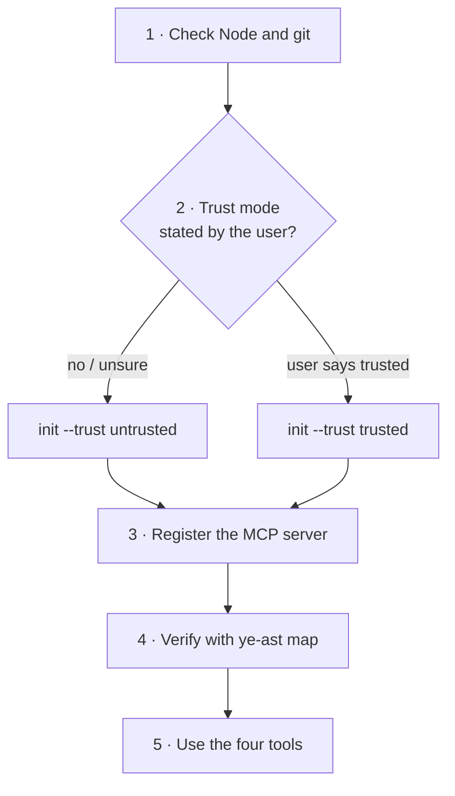
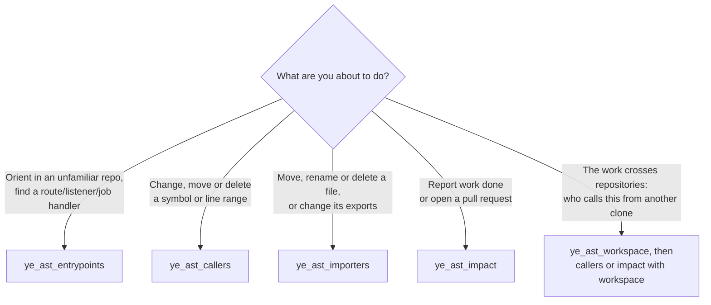
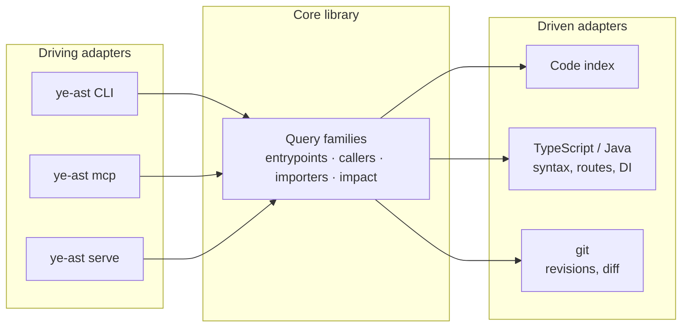

<div align="center">


<i>"What breaks if I rename this?" · "Which screen uses this?" · "Is this file really dead?" · "What does my branch touch?"</i>

[](https://www.npmjs.com/package/ye-ast-mcp)
[](LICENSE)
[](package.json)
[](#3-register-the-mcp-server)

**[What is ye-ast](#what-is-ye-ast) · [Live explorer →](https://arielfalcon.github.io/ye-ast/) · [For AI agents →](#for-ai-agents-install-and-configure-ye-ast)**

</div>

---

## What is ye-ast

Your AI agent reads a handful of files and guesses the rest: it renames a function, says "done", and two days later a
screen that called it through a path the agent never opened is broken.

ye-ast gives the agent **the map**: every answer carries the file and line it came from, or an explicit "I cannot tell",
never a silent empty list. The questions it settles:

- **What does my branch touch?** Everything downstream of the change, plus the routes it adds, removes or alters.
- **Who calls this?** Every caller of a function or a line range (in every repository related, not just the current one), before you rename or delete it.
- **Which screen or endpoint ends up running this?** UI routes, HTTP endpoints, message listeners and scheduled jobs.
- **Is this file really dead?** Who imports it and who uses it, file by file.

It is deterministic and read-only: the answers come from your code and your git history, never from a model, so the same
repository gives the same bytes. It runs nothing from your repository, needs no secret, and under the default
`untrusted` mode makes no network request. It speaks MCP, so Claude Code, OpenCode, Codex and any other client can use it.

```bash
npx ye-ast-mcp init --trust untrusted .   # one command; paste the line it prints into your agent
```

TypeScript and Java today, with Angular routes and Spring endpoints; anything else is reported as not covered. It answers
structure, not intent: "what reaches this?", never "is this code good?". Version 0.x: solid answers, a surface that may (will) change.

**Markdown descriptions are boring.** [Walk the graph yourself](https://arielfalcon.github.io/ye-ast/).

---

<div align="center">

## For AI agents: install and configure ye-ast

<sub>Everything below is written for an agent. Humans are welcome, but it gets technical from here.</sub>

</div>

You are an agent asked to add ye-ast to a repository and use it. Follow the steps in order. Every command is exact and
every expected result is stated.

> [!IMPORTANT]
> **Do not skip step 2 and do not choose `trusted` for the user.** The trust mode is the user's decision.



### Contents

1. [Check the preconditions](#1-check-the-preconditions)
2. [Declare the trust mode](#2-declare-the-trust-mode)
3. [Register the MCP server](#3-register-the-mcp-server)
4. [Verify before reporting success](#4-verify-before-reporting-success)
5. [Choose the tool](#5-choose-the-tool)
6. [Read the answer correctly](#6-read-the-answer-correctly)
7. [Failures and what they mean](#7-failures-and-what-they-mean)
8. [Rules you must respect](#8-rules-you-must-respect)
9. [CLI reference](#9-cli-reference)

### 1. Check the preconditions

```bash
node --version                  # must be v24.15.0 or newer
git --version                   # must be 2.44 or newer
git rev-parse --show-toplevel   # must print the repository root
```

| If | Then |
|---|---|
| Node is older than 24.15 | Stop and tell the user. The engine uses `node:sqlite` and refuses to run. |
| The directory is not a git repository | Stop. Every fact reads git history. |
| `git rev-parse` prints a different root than the path you were given | Use the printed root as `<repo>` in every step below. |

The npm package is `ye-ast-mcp`; the command it installs is `ye-ast`. Every step works without a global install
through `npx --yes ye-ast-mcp …`. With `npm install -g ye-ast-mcp`, replace `npx --yes ye-ast-mcp` with `ye-ast`.

### 2. Declare the trust mode

The two modes describe the **repository content**, not the machine, and are recorded **outside** the repository.
Nothing inside a repository can raise its own mode. With no declaration, the CLI and the MCP server run `untrusted`.

| Mode | What ye-ast does | Use when |
|---|---|---|
| `untrusted` (default) | Reads only a snapshot exported from git at a sha. No network request, no repository manifest, no repository `.gitignore`, no repository code, no symlinks. | Always, unless the user says otherwise. Every query against a committed revision works. |
| `trusted` | Also allows `live`: reads the working tree (uncommitted and untracked files included) from ye-ast's own mirror, and refreshes declared remotes with the user's git. | Only when the user explicitly says the repository content is trusted. |

Ask the user only if you cannot decide from context. Never infer consent from the fact that the repository is theirs.

```bash
npx --yes ye-ast-mcp init --trust untrusted /path/to/repo
```

Expected output, one item per line:

```text
trust: untrusted (recorded outside the repository)
local exclude: added .ye-ast/ .ye-ast-graph/
.ye-ast/README.md: written
.ye-ast/entrypoints.json: written
register the MCP server with Claude Code:
claude mcp add ye-ast -- npx --yes ye-ast-mcp mcp /path/to/repo
```

What `init` did:

- recorded the trust declaration in `$XDG_CONFIG_HOME/ye-ast/` (`~/.config/ye-ast/` by default);
- wrote the fixed layer under `.ye-ast/` (owned by `init`; never edit it by hand);
- added `.ye-ast/` and `.ye-ast-graph/` to `.git/info/exclude`, so nothing reaches the user's commits;
- printed the MCP registration for **this** machine. Use that last line in step 3.

To install several explicitly selected roots with one trust choice, name a launch root and each additional binding:

```bash
npx --yes ye-ast-mcp init --trust untrusted --repo web /path/to/web /path/to/api
```

The launch root is also selected; include `--repo api /path/to/api` to choose its ID explicitly. The first output line is a
JSON report for every selected root. When every installation and fixed layer succeeds, the second line is a JSON object
with `command` and `args` for the MCP host. No registration is emitted on an incomplete batch. A workspace manifest
applies only to the launch root and never selects additional trust targets. Each trust write is independent; a later
failure does not undo an earlier one. Review the report before retrying. A `not-attempted` target has not been
validated; if launch identity resolution stops early, an empty launch ID means its name has not yet been established.

### 3. Register the MCP server

A server has a launch root (the working directory when omitted) and may declare additional roots with repeatable
`--repo <id> <root>` pairs. For example, `ye-ast mcp /path/to/api --repo web /path/to/web` makes `web` available
as a tool's `repo` selector. Paths resolve against the launch working directory and must be Git worktree roots;
canonical duplicates must have the same ID, and different worktrees need distinct IDs. A declaration for the launch
root can override its default name. The host registration owns this catalog; availability grants neither trust nor
workspace membership. Only the launch root is warmed. Local evidence paths are relative to the selected root;
workspace evidence belongs to its recorded owner.

<details open>
<summary><b>Claude Code</b></summary>

User scope (available in every session):

```bash
claude mcp add ye-ast -s user -- npx --yes ye-ast-mcp mcp /path/to/repo
```

Project scope (writes `.mcp.json`, shared with the team): replace `-s user` with `-s project`.

</details>

<details>
<summary><b>OpenCode</b></summary>

Merge into `opencode.json` (project) or the global config:

```json
{
  "$schema": "https://opencode.ai/config.json",
  "mcp": {
    "ye-ast": {
      "type": "local",
      "command": ["npx", "-y", "ye-ast-mcp", "mcp", "/path/to/repo"],
      "enabled": true
    }
  }
}
```

</details>

<details>
<summary><b>Any other stdio MCP client</b></summary>

| Field | Value |
|---|---|
| transport | stdio |
| command | `npx` |
| arguments | `-y`, `ye-ast-mcp`, `mcp`, `/path/to/repo` |

</details>

<details>
<summary><b>More than one repository</b></summary>

Register one entry per repository, each with its own name and path:

```bash
claude mcp add ye-ast-api -s user -- npx --yes ye-ast-mcp mcp /path/to/api
claude mcp add ye-ast-web -s user -- npx --yes ye-ast-mcp mcp /path/to/web
```

</details>

### 4. Verify before reporting success

Run the same query through the CLI. It is the same engine the MCP server uses:

```bash
npx --yes ye-ast-mcp map /path/to/repo
```

- [ ] Exit code is `0`.
- [ ] stdout is one JSON object with `schema`, `snapshot`, `producer`, `inputs`, `evidence`, `status` and `value`.
- [ ] `status` is `complete` or `partial`. Both are valid answers.
- [ ] `value.entrypoints` is an object, not `null`.
- [ ] If the client lists MCP tools: `ye_ast_entrypoints`, `ye_ast_callers`, `ye_ast_importers`, `ye_ast_impact`, `ye_ast_outline`, `ye_ast_workspace`, `ye_ast_decisions` and `ye_ast_compose`
      appear. The client may need a restart to pick up a new server.

A non-zero exit code is a query problem, not a registration problem: read [step 7](#7-failures-and-what-they-mean).

### 5. Choose the tool



| Tool | Call it when | Key arguments |
|---|---|---|
| `ye_ast_entrypoints` | Find supported HTTP/UI routes, listeners and jobs | `revision`, `live`, `scope`, `mode`, `select`, `page`, `expect` |
| `ye_ast_callers` | Find dependents and reached entrypoints for a declaration or line range | `targets`, `revision`, `live`, `scope`, `budget`, `workspace`, `mode`, `select`, `page`, `expect` |
| `ye_ast_importers` | Investigate file moves, renames and export changes | `files`, `revision`, `live`, `scope`, `mode` |
| `ye_ast_impact` | Investigate consequences of a diff | `base`, `head`, `live`, `changed`, `scope`, `budget`, `workspace`, `mode`, `select`, `page`, `expect` |
| `ye_ast_outline` | Find declarations, spans and imports in selected files | `files`, `revision`, `live`, `scope`, `mode` |
| `ye_ast_workspace` | Discover outward names and candidate local repositories | `repos`, `gateways`, `revision`, `live`, `offline`, `scope`, `mode` |
| `ye_ast_decisions` | Find workspace configuration gaps and evidence-backed options | `repos`, `gateways`, `revision`, `live`, `offline`, `scope`, `mode` |
| `ye_ast_compose` | Combine related queries into shared entities, relations and evidence with source provenance | `queries`, `mode`, `expect`, `deadlineMs` |

There are seven query families and one composition operation. Once the relevant files or symbols are known,
`ye_ast_compose` can execute related queries and return their combined evidence:

```json
{
  "queries": [
    { "name": "ye_ast_entrypoints", "arguments": { "repo": "shop", "revision": "main" } },
    { "name": "ye_ast_outline", "arguments": { "repo": "shop", "revision": "main", "files": ["src/OrderController.java"] } }
  ],
  "mode": "details"
}
```

For a stable investigation, replace `main` with the full SHA returned by a preceding query. Dependent queries still
require their coordinates first; the batch has no variables or implicit follow-up execution. It accepts 1–16 queries
and at most 1,048,576 UTF-8 bytes of canonical JSON arguments. Each query keeps its own trust, scope, budget and snapshot
rules. Duplicate queries execute once. A source fault fails the whole composition; a partial or unknown fact retains
its recorded limits. A batch is not an atomic snapshot of the workspace.

Summary/details explain findings, source states and every material limit in the presentation; their
`composition-receipt` in the `result JSON:` line contains only version/mode, verification and complete safe repeat
queries. `S1` in text names `requests[0]`, and so on. Full returns
`kind: "composition"`, with normalized tables under `graph`, source states and issues under `coverage`, and repeat
queries under `requests`. Identical entities and evidence are shared; relation attestations preserve their sources and
categories. File imports do not establish symbol calls, and reachability does not establish breakage. Different
snapshots stay separate even when names and paths match. Outline supplies structure, not source text. Changed contract
operations keep their document, line and changed data sides; a link that calls a changed operation does not prove
that the changed data is read.

Compose reexecutes queries and retains no final results between calls, so it can cost more analysis time than using
answers already available. For a recoverable source, its repeat request is `pinned-replay` with the original `mcp-r1`
assertion; importers, outline, workspace and decisions use `fresh-read`. A root `expect` checks the composition's
`verification.identity` (`mcp-c1`); changed or unavailable context fails explicitly. Nested `mode`, `select`, `page` and
`expect` inside `arguments` are rejected. The three recoverable query objects may carry a sibling source `expect`.
Composition has no `select` or pagination; use the original source tool and its supported controls for further evidence.
Details shares uniform provenance; full retains every producer, engine, read and support. Exact repeated positive
observations can corroborate across producer policy versions while preserving both versions; derived connections keep
strict producer compatibility. Neither operation parses version suffixes or treats an import as a call. Optional
collection metadata separates an absent field from a present array and its recorded count; a present empty array is
zero observations, not a positive finding.

How the arguments behave:

| Argument | Meaning |
|---|---|
| `repo` | Exact declared repository ID on any tool. Omit for the launch root. An unknown ID fails; it is never treated as a path. |
| `revision` / `head` | Any git revision. Default: `HEAD`. |
| `live` | Read the working tree instead of a revision. Requires the repository’s current `trusted` declaration. Omit `revision`/`head` when true. Local-only live queries also exclude `offline`; workspace queries may combine `live` and `offline`. |
| `workspace` | `{ repos: [{ path, id?, revision? } or { path, id?, live: true }], gateways?: [{ prefix, repo }] }` on `callers` and `impact`: other **local** clones whose call sites are joined to the routes and listeners the walk reaches. The answer adds the links (with their basis: `exact`, `gateway-prefix`, `route-overlap`, `base-path`, `suffix`, `event-destination`), each with its direction (`upstream` for what reaches the change, `downstream` for what a change sends onward) and the links crossed from the change (`reach`), followed to a fixpoint across repositories; what depends on those call sites in their own repository, the call sites that reached a declared service and matched none of its entrypoints (`unmatched`), the ones that name a service no clone serves (`external`), and every call site whose target the code does not decide as a cut. A gateway prefix needs no declaration when the routes show it; `gateways` overrides it, and a declared gateway no call site names, or whose repository was not passed, is listed as matching nothing. Without `repos` the repositories and gateways the user persisted with `ye-ast init --workspace <file>` are used, and a repository that persists none answers about itself alone; the manifest holds the same object, its relative paths resolved against the installed repository. A repository the request does not name keeps the directory name of its path in every snapshot, so a linked worktree is passed with `id` set to the name of the clone that holds it when both must answer as one; the selected trigger uses its declared ID (the default launch name comes from its main worktree). Every answer says which of the two declared its repositories (`workspace.source`: `request`, `persisted` or `none`), so an answer about the bound repository alone is never read as a workspace with no impact. Each clone is read at its own snapshot under its own trust declaration; trusted persisted remotes may refresh unless `offline: true`. Each repository may choose a revision or live capture; a member cannot override the selected trigger. Without `workspace` the answer says nothing about other repositories. |
| `scope` | `{ include?: [globs], exclude?: [globs] }` over repository-relative paths; `exclude` wins. `include` selects the content the answer is about, and the configuration that interprets it (a `package.json`, a `tsconfig`, a build file, a Spring `application` file, an OpenAPI document) remains available under `include`; an explicit `exclude` can remove it. A path outside the scope is **not answered about**, so callers and entrypoints through it are not known; the answer names its scope under its status. Use it to keep one service or package apart, not to shorten an answer. |
| `changed` | On `impact`, globs over the changed paths the scope leaves: only the change's paths they select seed the walk. Callers outside that selection remain eligible within the declared scope, subject to recorded cuts; `changed` does not itself narrow consequence coverage. Use it on a large change to answer one area at a time. A glob that selects no changed path is an error, never an empty answer. A file the index could not read stays a cut even when the selection leaves it out: its blindness belongs to the whole walk. |
| `budget` | `{ depth?, hubFanIn?, expansions? }`, positive integers, no defaults. Limits traversal work, not response length. `depth` counts incoming dependency levels, not hops between services. A bound that stops a walk is reported as a cut, never as a silent truncation. |
| `mode` | `"summary"` (default) identifies findings and limits; `"details"` adds recorded explanatory evidence and locations; `"full"` returns the full redacted public fact in `structuredContent` with a contextual text guide. Choose any mode directly. None changes coverage, traversal or snapshots. |

### Select recorded evidence

`ye_ast_entrypoints`, `ye_ast_callers` and `ye_ast_impact` accept `select`, `page` and `expect`:

| Tool and scope | Selectable evidence |
|---|---|
| `entrypoints` | `entrypoint-evidence` by `findingIndex`; `cut-places` owned by the fact or entrypoints section |
| `callers`, local | `handler-origins`; fact-owned `cut-places` |
| `impact`, local | `handler-origins`, `module-origins`; fact-owned `cut-places` |
| `callers` or `impact`, workspace | Section-owned `handler-origins`, fact/section/read-owned `cut-places`, and `workspace-link-evidence` by link ID; `module-origins` is supported only by `impact` |

Coordinates are from the public result: handler path, symbol and line with a local or repository section owner;
module file and `base`/`head` side with its owner; a zero-based finding or cut index; or a link ID. Read owners
also include the zero-based read index. For example, after obtaining an available `recovery` from a callers result,
use its exact `query.name` and `query.arguments` and add these controls (the handler is a lookup example):

```json
{
  "select": { "kind": "handler-origins", "owner": { "kind": "local" },
    "handler": { "path": "src/controller.ts", "symbol": "Controller.run", "line": 12 } },
  "page": { "limit": 1 },
  "expect": "<recovery.resultIdentity>",
  "mode": "full"
}
```

The example's controls are merged with the returned query arguments, including its pinned revision or live selector.
`select` and `page` must appear together; `limit` is an explicit positive safe integer. There is no default page size
or byte cap. Pass the returned `nextCursor` in `page.cursor` with the same selection and limit. `expect` can also assert
an unselected query; when used with a cursor it must match its identity. Each page reexecutes the query and verifies
source identity before delivering selected data. A changed source fails rather than restarting pagination. Live replay
reads current state; no old live capture or final answer is retained.

A selected full response is a projection with context and page records; summary/details return projection receipts and
render those records in text. Full text guides the reader to the structured page while retaining source limits, page
continuation and the recovery recipe. Repeated presentation context may be shared across explicitly associated rows;
literal selector examples and each row's coordinates remain available. Source analysis and owner limits remain distinct from page availability: an available
zero-item page is not an unknown or unavailable source, which carries its actual reason and evidence. Selection does
not change analysis scope or traversal budgets. The public redaction boundary also applies to evidence and recipes;
internal source sidecars are not exposed.

Recovery metadata is delivered once at `structuredContent.recovery` in every mode, including selected pages. Text points to that field instead of copying the recipe or result identity; unavailable recovery states its reason. Clients must expose structured content to use recovery.

MCP text responses share status, scope, snapshot and recovery conventions across tools. Selected evidence keeps
each read's owner and uncertainty, with explicit snapshot/scope/configuration overrides. When importer paths are
counted, one recovery instruction covers the target-file category; each target retains its own counts.

Selected source text retains root context, read owners and analysis (including unknown reasons), and owner limits. Reads explicitly inherit matching snapshot, trust, declared scope and configuration; overrides are printed. Complete provenance catalogs remain in `structuredContent.source`. Handler and module categories provide literal selector examples; each row keeps its named JSON coordinate, distinct span/depth/confidence and origin facts. Shared origin headings apply only to the stated following rows. Category recovery rules cover recorded counts/examples without adding presentation caps. Structured provenance, recovery and pagination contracts are unchanged.

`importers` lists each related path once per target. Detailed rows retain its static, reexport, dynamic and type
import memberships, users and unresolved name matches, with zero-based positions in the original categories.
Users without a module category are additional users. The distinct-file count counts each path once, while category
counts retain overlapping memberships. An import does not prove declaration usage, and a name match does not prove a
dependency. The default summary counts categories when that is shorter than listing them; use `mode: "details"`
for paths and memberships.
With `mode: "full"`, the original overlapping `importers`, `users` and `unresolvedNamers` arrays and all cuts remain in
`structuredContent`; text acknowledges the status and guides navigation. These presentation choices preserve coverage,
snapshots and completeness. For a committed read, pin `revision` to the returned SHA when requesting another
presentation. A live `head` and `stateId` identify working-tree content that cannot be pinned or retrieved by
`revision`; another live call may observe different content. Do not combine `live` with `revision`.

For `impact`, start with `{"base":"main"}` (replace the branch with the actual merge destination).
Use `{"base":"main","live":true,"changed":["src/api/**"]}` for trusted working-tree changes in one area,
retaining consumers elsewhere within scope. Use
`{"base":"main","changed":["src/api/**"],"workspace":{},"offline":true}` for committed cross-repository
analysis with eligible persisted workspace membership and no remote refresh. Omitting `workspace` is a local query;
`workspace: {}` enables persisted defaults and reports when none exist. `offline` has no effect on local queries.

To repeat the same committed question, set `head` to its recorded SHA and retain `base` and `changed`; for a workspace,
use the returned recovery recipe and echo its ordered snapshot vector. A live replay captures again and succeeds only if head and stateId still match; it cannot retrieve an old working tree. Workspace captures are not an atomic instant.

Impact text locates both the call site and destination handler of each cross-repository link. The numbered `reach`
references identify the recorded links crossed from the change, nearest first; they do not invent a path inside a
repository. A shared `via` heading applies to the declarations indented beneath it and retains their dependency
locations. Workspace cuts are grouped by their owning repository so identical relative paths in different clones
remain distinct. Impact/callers detailed text shows one verified origin association per entrypoint, without ranking
it or claiming a complete call chain. Its symbol evidence covers the nearest recorded consequence depth and the
reached handlers; other symbols are counted, with a literal listing when shorter. Change origins supplying that
evidence remain localizable. Cut details keep anchors and limits while counting repeated reference places.
Unserved names can be counted in either text level. Use `mode: "full"` for exhaustive symbols, seeds, associations,
reference places and names. Counted omissions concern presentation, while `partial` and cuts describe missing
analysis coverage. Related `outline`, `callers` or `importers` queries do not filter the original impact fact.

When needed, impact/callers answers include a contextual investigation guide. It identifies useful full-JSON lookups,
matching fields and joins for the data present: entrypoint origin indexes belong to that walk's seed array,
workspace links join by link ID, and repository evidence stays in its owning section. Unknown answers guide you
to reason/evidence instead of an absent value. Fault responses retain their typed metadata and explain an applicable
correction or the prerequisite to inspect before retrying.

Working rules:

- Use the tools when their recorded facts answer the question; they do not judge style, naming or syntax.
- When investigating a declaration before deletion, `ye_ast_callers` can identify its dependents. After deletion,
  `ye_ast_impact` can only report remaining recorded evidence.
- Name symbols as they are declared in the file: `placeOrder`, or `OrderService.placeOrder` for a member.
- To shorten an answer, use `mode`, not `scope`: a scope hides whatever lies outside it, routes included.
- On a change that touches many files, pass `changed` with the globs of the area you are answering about. Callers
  outside that selection remain eligible within `scope`, subject to recorded cuts; `changed` does not itself narrow
  consequence coverage.

### 6. Read the answer correctly

A CLI or query-protocol fact has this envelope; MCP text modes return a smaller receipt as described below:

```text
schema     contract version of the envelope
snapshot   what was read: { repo, kind: "sha", sha } or { repo, kind: "live", head, stateId }
producer   ye-ast name and version
inputs     trust mode, declared scope, change selection, budget
evidence   [{ path, line, endLine? }] that support the value
status     complete | partial | unknown
value      the fact itself (in MCP structured content when mode is "full" and status is known)
```

| `status` | Means | What you report |
|---|---|---|
| `complete` | Everything inside `inputs.declaredScope`, and the part of the change `inputs.declaredConfig.changed` selects, was read | The answer, and that it holds **inside** the declared scope and selection only |
| `partial` | The answer stops at each entry in `cuts`; what lies past a cut is **not known** | Inspect cuts whose missing information matters to the task. Increase a traversal bound when applicable; ambiguous targets, dynamic URLs and missing extractors require source evidence or a declaration, not a larger walk budget. |
| `unknown` | ye-ast cannot tell; `reason` says why | The reason. **Never** translate it into "no impact" |

> [!WARNING]
> A complete empty list means no recorded result within its declared scope. `unknown` or a cut is not proof of absence; report the limitation.

An item can also be `unknown` inside a `complete` answer: an entrypoint whose target the sources do not resolve, or a
source no `package.json` above it places in a project (`no-project`). The collection is complete because nothing bounded
it; the item says what could not be known at its place (RFC-0002 rule 2).

`complete` stays relative to the declared scope, and the scope now separates content from interpretation: `include`
selects the content the answer is about, and the configuration that interprets it — a `package.json`, a `tsconfig`, a
build file, a Spring `application` file, an OpenAPI document — is always read, so narrowing the scope never removes what
an extractor needs to place a source. `exclude` still wins over both, and a path a tool is asked about outside the scope
stays out of scope.

Also:

- Quote the `snapshot` when you report a fact, so the user knows which revision it describes.
- Unselected MCP summary/details return a strict receipt: `{ mode, status, snapshot }`, plus `reason` exactly when status is
  unknown. They do not include the fact body, cuts or sidecar arrays. Full returns the redacted fact plus `mode` and
  applicable `repositoryRoots`, `freshness`, `resolution`, `live` and `workspaceLive` siblings; `_meta["ye-ast/live"]` also carries a
  stale notice. Full known facts require a value, partial facts require cuts, and unknown facts require a reason and no
  value. The published output schemas validate the common envelope, snapshot identity and principal family containers
  and coordinates, not every domain leaf. Full payloads permit additive public fields; receipts are strict.
- The migration is breaking: replace `detail: "summary"` with `mode: "summary"`, `detail: "full"` with
  `mode: "details"`, and `full: true` with `mode: "full"`. The old arguments are rejected, including `full: false`;
  there are no compatibility aliases. A client may expose both text and structured content to a model; do not assume
  either channel is hidden. Full text guides the structured result instead of repeating the family listing.
- Coverage exclusions, traversal cuts and presentation omissions are different: scope excludes analysis, cuts record
  bounded or unresolved analysis, and omissions count recorded items hidden from text and recoverable in full.
- For foreign evidence, choose its declared owner with `repo` and its recorded SHA with `revision` for a related
  `outline` or `callers` query. Base-side modules use the recorded merge-base SHA. Symbol names may match multiple
  declarations. An undeclared owner needs an updated host registration or an instance bound to that clone. A live
  follow-up is a fresh read: compare its head and stateId with the earlier result; a past live state cannot be requested.
- A place carries its span when its declaration is longer than one line: `src/a.ts:3-9`. An impacted symbol or a seed
  prints the same span (`3-9 A.seed`), so a read can name exactly the range it needs.
- A symbol reached through another one prints `via <file>:<symbol> at <lines>`: the lines are **inside the symbol itself**,
  the places where it depends on what reached it; a recorded dependency does not by itself prove a change is needed. When the store places no line for that dependence, the same slot names what it is instead: `(call)`,
  `(reference)`, `(contains)`, `(dispatch)`, `(relation)`, `(import)`; none of them is a missing answer. An `at` list with
  no parenthetical is a call.
- Summary and details state status, scope and snapshot; refreshed reads also show remote freshness and pinned revisions.
  Full text acknowledges the status and guides navigation of the structured result and its available sidecars.
- `_meta["ye-ast/live"]` on a local live answer means the working tree moved during the read; the answer may be stale. Workspace notices appear in `_meta["ye-ast/workspace-live"]` in every mode and identify the repository and captured snapshot. A staleness-unavailable notice does not claim freshness.
- An `isError` result carries a fault kind on its first text line and the same `{ kind, detail, entries? }` in
  `_meta["ye-ast/fault"]`; see the next step.

### 7. Failures and what they mean

| Symptom | Cause | Action |
|---|---|---|
| `ye-ast: unreadable: …` | The path does not exist, is not a directory, or the account cannot read it | Fix the path; do not retry blindly |
| `ye-ast: live-requires-trusted` | `live` used without a `trusted` declaration | Ask the user, or answer from a revision |
| `ye-ast: unknown-symbol: …` | Nothing declares that symbol at that revision | Check the file and the name; the error lists what it found |
| `ye-ast: deadline` | The walk ran out of its bound | Narrow `scope`, or raise `budget` |
| `ye-ast: caller-budget` | A host-set export budget stopped the read | Raise the budget set by the host |
| `ye-ast: unsupported-store: …` | An index store outside the supported schema | Let ye-ast rebuild its index |
| Tools missing in the client | Server not registered, or client not restarted | Re-run step 3, restart the client, re-check step 4 |

| Exit code | Meaning |
|---|---|
| `0` | OK |
| `1` | The query failed with a typed fault (table above) |
| `2` | Usage error: re-read `ye-ast --help` |
| `70` | Internal fault: report the message, do not retry in a loop |
| `130` | Interrupted |

### 8. Rules you must respect

- ye-ast is **read-only** toward the repository. Never write, edit or delete files to make a query succeed.
- Never fabricate a fact. If the answer is `unknown` or cut, report that.
- Never mark a repository `trusted` on your own initiative.
- Under `untrusted` ye-ast makes no network request; do not work around that by fetching the repository yourself.
- The fixed layer under `.ye-ast/` belongs to `ye-ast init`. Do not edit it by hand.

### 9. CLI reference

The CLI answers the same questions as the MCP tools, as one JSON object on stdout. Use it in scripts, CI, or to verify
an MCP answer.

```bash
ye-ast map .                                    # entrypoints at HEAD
ye-ast impact --base main .                     # what the current branch affects
ye-ast callers . src/checkout.ts:placeOrder     # who depends on a symbol
ye-ast callers . src/checkout.ts:40-72          # who depends on a line range
ye-ast importers . src/checkout.ts              # who imports or uses a file
ye-ast map --live .                             # the working tree (trusted only)
```

| Command | Answers |
|---|---|
| `ye-ast map [--revision <rev> \| --live] [scope] <repo>` | Entrypoints of a revision |
| `ye-ast impact --base <rev> [--head <rev> \| --live] [scope] [changed] [budget] <repo>` | What depends on the change from the merge base to the head |
| `ye-ast callers [--revision <rev> \| --live] [scope] [budget] <repo> <file>:<symbol> \| <file>:<start>-<end> …` | What depends on symbols or line ranges |
| `ye-ast importers [--revision <rev> \| --live] [scope] <repo> <file> …` | Per file: importers, users and unresolved namers |
| `ye-ast outline [--revision <rev> \| --live] [scope] <repo> <file> …` | Per file: its declarations with their spans, and what it imports |
| `ye-ast workspace [--revision <rev>] [--offline] [scope] <repo>` | The outward names the bound repository and the workspace it persists state, the local repository that serves each, and the names nothing serves |
| `ye-ast decisions [--revision <rev>] [--offline] [scope] <repo>` | The gaps the same workspace leaves to the user, each with every option the workspace can verify |
| `ye-ast init --trust trusted\|untrusted [--workspace <file>] [<repo>]` | Declares the trust mode, writes the fixed layer (and the workspace manifest given, once every repository it names is a readable repository root), prints the MCP registration |
| `ye-ast mcp [<launch-root>] [--repo <id> <root>]...` | Read-only stdio MCP server with a declared repository catalog |
| `ye-ast serve` | The query protocol over stdio, one JSON-RPC 2.0 message per line |

The query protocol carries mixed live and committed workspace selectors, but default `ye-ast serve` runs untrusted,
ignores user trust records and refuses live workspace reads. MCP and library live reads require repository trust.
The `workspace` and `decisions` CLI commands and local query RPCs use committed revisions. Protocol workspace results
retain host read-location metadata in `repositorySources` for compatibility.

| Option group | Syntax |
|---|---|
| `scope` | `[--include <glob>]… [--exclude <glob>]…` over repository-relative paths; `--exclude` wins |
| `budget` | `[--depth <n>] [--hub-fan-in <n>] [--expansions <n>]`; positive integers, no defaults |
| identity | `--repo-id <id>` names the repository in every snapshot; without it the name is the directory of the repository's main worktree, so every linked worktree of one repository answers the same name |
| measurement | `--measure` writes one JSON measurement line per query and per index build to stderr, never stdout |

<details>
<summary><b>Embedding the engine as a library</b></summary>

For a host that runs the engine in its own process:

```js
import { composeQueries } from "ye-ast-mcp";

const { entrypoints, impact } = composeQueries({ indexCache: "/var/cache/ye-ast" });
const result = await impact.callers({
  repo: "/path/to/repo",
  repoId: "my-app",
  revision: "HEAD",
  targets: [{ file: "src/checkout.ts", symbol: "placeOrder" }],
});
```

`composeQueries` returns the read query families and `warmLive`; nothing it exposes can write.

</details>

<details>
<summary><b>How it is built</b></summary>



The core is a library with ports; the CLI, the MCP server and the query protocol are thin adapters over it. The same
core answers a one-shot `ye-ast impact` in CI and an on-demand `ye_ast_impact` from an agent. Design records live in
[docs/architecture](docs/architecture/README.md).

</details>

<details>
<summary><b>Development</b></summary>

```bash
nvm use
npm ci
npm run check     # typecheck + architecture rules + tests
npm run cli -- map .
```

`npm run arch:check` enforces the layers: domain and ports never reach a Node built-in, application never reaches an
adapter, and an entrypoint never imports another entrypoint.

</details>

---

<div align="center">

Apache-2.0 · See [LICENSE](LICENSE)


</div>
